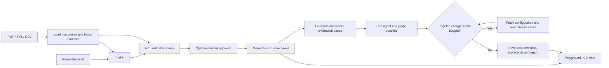

# ForgeAI

## Project Overview

ForgeAI is an autonomous agent factory. It turns a requester brief and a folder of documents into a configurable, source-grounded agent, generates and freezes an evaluation set, and measures targeted improvements. The generated agent can be loaded in Streamlit or the CLI. Each full run saves the agent definition, evaluation traces, scorecards, and a quality report.

## Core Features

1. **Intake interview.** Ask up to five clarifying questions, or run unattended and record assumptions and unresolved decisions.
2. **Groundability check.** Review requested capabilities against document evidence and available tools. Flag unsupported requirements, including live data missing from static sources.
3. **Agent generation.** Save a validated definition with instructions, retrieval settings, an output contract and a tool allowlist.
4. **Evaluation generation.** Generate at least 20 distinct cases covering direct answers, refusals, ambiguity and cross-document evidence. New runs also exercise contextual follow-ups, false premises, mixed scope and instruction overrides.
5. **Automated judging.** Combine a fixed semantic rubric with deterministic checks for evidence, citations, numeric provenance and expected behavior.
6. **Critic and optimizer.** Diagnose failures, apply a targeted change, then score the same frozen cases. Run up to three iterations after baseline and retain the best measured version.
7. **Reporting.** Save the selected definition, per-case results, iteration changes, scorecards and remaining limitations.
8. **Runnable agents.** Load any saved definition in Playground or the CLI. Playground shows citations, retrieved passages and tool activity.
9. **Two end-to-end demonstrations.** Museum collections and spare-parts procurement are the two primary submissions. Academic policy is a supplementary run.

The Streamlit interface also supports human approval of requirements, conversation reset, a Grounding switch and artifact downloads. A prototype-only mode saves an agent before evaluation.

| Assignment requirement | Implementation | Reviewer check |
| --- | --- | --- |
| R1 Intake | [intake.py](backend/forgeai/intake.py) | Open a run's requirements or enable interactive intake. |
| R2 Groundability | [coverage.py](backend/forgeai/coverage.py) | Inspect `coverage.json` for source quotes and limitations. |
| R3 Agent generation | [generator.py](backend/forgeai/generator.py) | Inspect `agent_config.json` for the prompt, retrieval settings, output contract and tools. |
| R4 Evaluation generation | [evaluation.py](backend/forgeai/evaluation.py) | Compare `eval_dataset.json` with the recorded source anchors. |
| R5 Judge | [judge.py](backend/forgeai/judge.py) | Open Evaluations or inspect `case_results/` for the rubric, evidence and decisions. |
| R6 Optimization | [optimizer.py](backend/forgeai/optimizer.py) and [workflow.py](backend/forgeai/workflow.py) | Open the Optimization Log to compare the changed fields, affected cases and scores. |
| R7 Reporting | [workflow.py](backend/forgeai/workflow.py) | Read `final_report.md` and `scorecards.json`, including errors and limitations. |
| R8 Runnable agent | [runner.py](backend/forgeai/runner.py) | Choose a saved agent in Playground or load its config with the CLI. |
| R9 Two demonstrations | [Museum](backend/artifacts/groq-museum-rehearsal-r2/) and [Procurement](backend/artifacts/groq-procurement-final/) | Compare the briefs, sources and complete evaluation histories. |

## System Architecture



## Technology Stack

| Layer | Implementation |
| --- | --- |
| Interface and API | Streamlit, FastAPI, Uvicorn, Pydantic |
| Model providers | Groq (GPT-OSS 20B and 120B), NVIDIA NIM, Cloudflare Workers AI, and local Ollama |
| Document ingestion | PyMuPDF for text-bearing PDFs, UTF-8 TXT and pandas for CSV |
| Embeddings and retrieval | Sentence Transformers `all-MiniLM-L6-v2` by default, CPU FAISS with normalized vectors, and exact CSV record matching when applicable |
| Tool registry | CSV lookup, calculator, current date, and keyless Open-Meteo current weather |
| Tests | pytest, FastAPI test client, and model and transport fixtures |

## Project Structure

```text
ForgeAI/
├── backend/
│   ├── api/                FastAPI service
│   ├── forgeai/            Factory, runner, CLI and versioned prompts
│   ├── demo_data/          Demo documents, briefs and synthesis prompts
│   ├── artifacts/          Definitions, frozen evaluations and reports
│   └── tests/              Automated regression tests
├── streamlit_frontend/     Streamlit app and API client
└── .streamlit/             UI configuration
```

## Setup and Installation

The commands below use Windows PowerShell. Install Python 3.13 and make sure `python --version` resolves to it. Access to the private GitHub repository is required for cloning.

**Terminal 1, backend**

```powershell
git clone https://github.com/ShubhangiDimri/ForgeAI.git
Set-Location ForgeAI\backend
python -m venv .venv
$python = '.\.venv\Scripts\python.exe'
& $python -m pip install -r requirements.txt
Copy-Item .env.example .env
notepad .env
& $python -c "from sentence_transformers import SentenceTransformer; SentenceTransformer('sentence-transformers/all-MiniLM-L6-v2')"
& $python -m uvicorn api.main:app --host 127.0.0.1 --port 8000
```

In `backend/.env`, set a valid `GROQ_API_KEY` or one of `GROQ_API_KEY_1` through `GROQ_API_KEY_4`. Optionally set `FORGE_GROQ_KEY_SLOT` to prefer a numbered key. For NVIDIA use `NVIDIA_API_KEY`. For Cloudflare set `CLOUDFLARE_ACCOUNT_ID` and `CLOUDFLARE_API_TOKEN`. Keep credentials server-side. The MiniLM command downloads weights on first use. The application then loads them from the local cache. Ollama requires a running server and an installed model tag.

**Terminal 2, frontend, from the repository root**

```powershell
python -m venv .\streamlit_frontend\.venv
$uiPython = '.\streamlit_frontend\.venv\Scripts\python.exe'
& $uiPython -m pip install -r .\streamlit_frontend\requirements.txt
$env:FORGEAI_API_URL = 'http://127.0.0.1:8000'
& $uiPython -m streamlit run .\streamlit_frontend\app.py
```

Open [Streamlit](http://127.0.0.1:8501) or the [FastAPI reference](http://127.0.0.1:8000/docs).

**CLI, from `backend/`**

```powershell
$python = '.\.venv\Scripts\python.exe'
$brief = (Get-Content -Raw .\demo_data\academic_factory_brief.txt).Trim()
& $python -m forgeai build --brief $brief --docs .\demo_data\academic --out .\artifacts\my-academic-run --non-interactive --model groq:openai/gpt-oss-20b --judge-model groq:openai/gpt-oss-120b --max-iterations 1
& $python -m forgeai chat --config .\artifacts\my-academic-run\agent_config.json
```

Use a fresh output directory for each build. Add `--prototype-only` to skip evaluation. To recover an interrupted evaluation, run `python -m forgeai evaluate --run <run-folder> --resume-generation` before the dataset is frozen, or use `--resume-scoring` after it is frozen. Use the backend environment and the run's original models and scoring configuration.

## How to Use

1. Open **Build Agent**. Enter a brief and upload PDF, TXT or CSV documents up to 10 MB per file, or choose a bundled dataset. A full evaluation needs at least two source documents for cross-document cases. Use prototype-only mode for a single document.
2. Select a model and iteration budget. With interactive intake enabled, answer any clarification questions and review evidence and limitations before approving. Leave it disabled for unattended execution.
3. Open **Evaluations** to inspect the frozen cases, per-case evidence, metrics and optimization log. An interrupted run can expose a retry or resume action.
4. Test the saved agent in **Playground**. Expand source passages and inspect tool activity. Use **Grounding OFF** to verify that the agent abstains from document-specific answers.
5. Open **Reports** to preview the selected definition, requirements, coverage and scorecards. Download individual files or the run ZIP.

## Demonstration Results

| Live run | Baseline | Iteration 1 | Retained | Change |
| --- | ---: | ---: | --- | --- |
| [Museum collections](backend/artifacts/groq-museum-rehearsal-r2/) | 13/20 | 14/20 | v1 | Clarified scope and disambiguation instructions |
| [Spare-parts procurement](backend/artifacts/groq-procurement-final/) | 12/20 | 11/20 | v0 | Tightened tool-selection instructions |
| [Academic policy, supplementary](backend/artifacts/groq-academic-final/) | 12/20 | 11/20 | v0 | Required verified citation excerpts |

Museum demonstrates an unattended policy build and a measured improvement. Procurement demonstrates CSV lookup and calculator use. Academic and Procurement retained their baselines because the candidate versions passed fewer cases on the same frozen questions. Academic baseline recorded one invalid route response. Procurement baseline recorded one judge HTTP 429. Both iteration runs and both museum versions recorded zero execution or judge errors.

Each run folder contains the definition, frozen dataset, raw results, scorecards, iteration log and final report. The [demo inputs and synthesis prompts](backend/demo_data/) and [evaluation prompts](backend/forgeai/prompts/) are included. See the [assignment verification](ASSIGNMENT_VERIFICATION.md) for the evidence mapped to all nine requirements.

The [retail retrieval replay](backend/artifacts/retail-retrieval-key3-candidate/comparison.md) is supplementary regression evidence. The [baseline](backend/artifacts/retail-retrieval-key3-baseline/) and candidate both scored **16/20** on the same corrected frozen dataset. Two clarification cases improved and two other cases regressed.

## Evaluation and Reliability

- Generated cases use source anchors and a frozen dataset hash. The judge reviews one anonymous response at a time using a consistent rubric. Deterministic citation, numeric and response checks limit reliance on the semantic judge.
- The critic classifies semantic failures as retrieval miss, prompt defect, hallucination or wrong refusal. It records the changed fields, rationale, affected cases and measured scores. Infrastructure errors are tracked separately.
- Hosted clients apply bounded retries and respect cooldowns. Configured Groq keys can rotate on the same model. Automatic provider selection is available for compatible calls. Agent and judge model IDs stay pinned within scored comparisons.
- Checkpoints preserve accepted drafts and per-case results. Resume checks protect comparison integrity against changes to the frozen dataset and recorded scoring setup.

## Testing

From `backend/`:

```powershell
& .\.venv\Scripts\python.exe -m pytest -q -p no:cacheprovider
```

**83 passed**, with one Starlette test-client deprecation warning. Automated tests use fixtures for model and provider behavior. The demonstration scores above come from saved live executions.

## Known Limitations

- Provider rate limits can pause an evaluation. Keep the run directory intact for recovery.
- Clarification and mixed-scope answers can still fail. Citation validation verifies provenance, while factual entailment and relevance still depend partly on the model.
- Small local models can be configured through Ollama. Full current factory performance on a small local model remains unverified.
- Historical scores predate the latest judge safeguards. Use a fresh pinned baseline to measure changes under the current rubric.
- Image-only PDFs require OCR before ingestion.

## Demo Video and Deployment

- **Demo video:** link pending.
- **Hosted Streamlit app:** link pending.
- **Hosted API:** link pending.

For Streamlit Community Cloud, use `streamlit_frontend/app.py` as the entry point and set `FORGEAI_API_URL` to the hosted FastAPI HTTPS URL. On the backend host, configure provider credentials, protect reviewer access and persist uploads and run artifacts across restarts.
